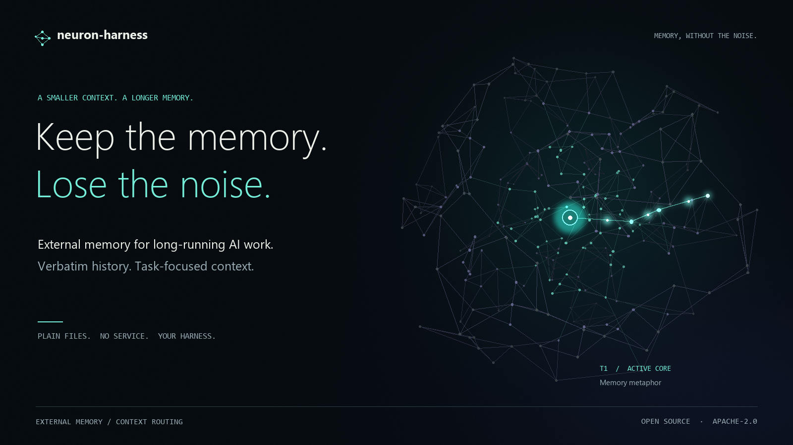
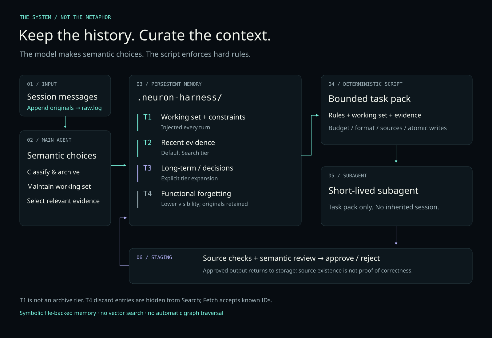

# neuron-harness skill

**A harness-agnostic Agent Skill for external memory and context routing in long-running tasks.**

[](https://github.com/BlackCatt99/neuron-harness-skill/actions/workflows/ci.yml)
[](LICENSE)
[](https://github.com/PowerShell/PowerShell)

**English** | [中文](README.md)



> **Goal**: every turn of a long-running session carries only what's relevant — less dilution of
> attention by history, and **nothing is ever lost**.
> **How**: move history outside the model, then repack on demand each turn.
> **Boundary**: this is **unbounded storage + bounded injection**, not an unlimited context window.

An external memory and context-routing **skill** for long-running AI sessions, not another agent
framework. **Not context
compression**: compression shortens history and loses detail; this doesn't compress — it selects.
All history stays on disk verbatim, and each turn only the relevant parts go into the model.

[](docs/brand/neuron-harness-film.mp4)

**[Watch the redesigned film (24s, silent)](docs/brand/neuron-harness-film.mp4)** · [Static preview](docs/brand/memory-network.png) · [Promo poster](docs/brand/poster.zh.png)

<details>
<summary>Full architecture: record → archive and select → task pack → subagent → staging review</summary>

[](docs/architecture.en.png)

Chinese edition: [architecture](docs/architecture.svg).

</details>

> Structurally neuron-inspired: T1 is the currently active core, T2–T4 spread outward toward the
> edge, and entries decay downward when untouched for a long time. Mechanically it is a symbolic
> system — keyword/tag matching, explicit tier parameters, absolute day thresholds. It is **not**
> weight matrices or vector similarity. That distinction matters: don't call it a neural network.

## What problem it solves

**The problem**: in long tasks the model is forced to carry its entire history every turn. The
longer the context, the more attention is diluted — the few genuinely relevant facts drown in a
pile of stale content. Brute-force compression, in turn, loses detail you can't recover later.

**The approach**: move both "what to remember" and "what to show this turn" out of the model into
auditable external state, and split the responsibilities:

- **The main model does only three things**: archive (split messages into entries), select (decide
  which old material this turn needs), assemble (emit the task pack).
- **The actual work goes to short-lived subagents**, each receiving one small clean task pack. They
  do not inherit the main session.
- **Nothing is ever deleted.** What looks like forgetting only lowers retrieval visibility
  (T1–T4 tiers) and raises the cost of reaching it — so it can be fetched back in full instead of
  being replaced by a summary.

## Why not just use an existing solution

Two commonly cited directions: [Letta / MemGPT](https://docs.letta.com/) and LangChain's built-in
memory. They solve different problems with different trade-offs; this is not a replacement.

| | Letta / MemGPT | LangChain memory | neuron-harness |
|---|---|---|---|
| Where memory lives | Memory blocks + archival storage, self-edited by the agent via tools | Checkpointer persists thread state; long-term memory plugs in separately | Plain text files in the project directory, reviewable with `git diff` |
| Who decides what enters context | The model, calling tools inside its agent loop | Application code configures trim / summarize / retrieval | The main model archives and selects per criteria; the script enforces hard rules |
| Is history compressed | Memory blocks in-context are summarization-style; raw text in archival layer | `summarization` middleware replaces earlier history with a summary | **Never.** Raw text persists in `raw.log` and `archive/` |
| Runtime required | Agent SDK, or self-hosted App Server / cloud | A library inside your application process | A single PowerShell 7 script — no service, no database |
| Auditability of state | Depends on its storage layer and API | Depends on the chosen checkpointer | Human-readable files + append-only logs, readable and editable directly |

**Trade-offs (not a ranking — it's about scenarios)**

- Need an agent to manage its own memory and accept a framework plus a storage layer → **Letta**.
- Need memory embedded in an existing application with precise code-level control over each turn's
  assembly → **LangChain**.
- Need external state that spans **sessions, subagents, and harnesses**, where raw text stays
  traceable, no service is involved, and a human can audit it with plain text tools → the target
  scenario for this project.

Deliberately out of scope: no vector search service, no agent self-editing memory, no hosted
platform. Retrieval is tag and keyword matching (see "Boundaries and known limitations"). That is a
deliberate simplification, not an unfinished feature.

## Boundaries and known limitations

Stating boundaries clearly is more useful than piling on selling points. Two categories:
**capability boundaries** are by design and won't change; **current limitations** are shortfalls of
this version and can be improved.

**Capability boundaries (by design)**

- **Does not enlarge the window.** Each turn's injection is capped by `budget` (default 24000
  characters); what the model can see at once is unchanged. Unbounded storage + bounded injection,
  not an unlimited context window.
- **Does not eliminate attention decay.** It reduces dilution — keeping irrelevant history out —
  but when the relevant material itself is large, decay still applies.
- **Does not guarantee complete recall.** Retrieval is based on tags, keywords and explicit tier
  parameters, **with no vector similarity**; paraphrasing can miss. A missed entry is not deleted —
  it just wasn't selected this turn. Expand tiers explicitly or `Fetch` it back.
- **Does not replace model judgement.** Which messages to archive, which to recall, whether a
  constraint's text is genuinely supported by the source — these semantic calls belong to the
  model. The script enforces only hard invariants: format, source existence, budget, locking,
  atomic writes.

**Current limitations (improvable)**

- Single global write lock: concurrency guarantees correctness, not throughput.
- `Next-Id` recursively scans the archive each time; numbering slows down past a few hundred entries.
- Semantic source validation only covers format and existence; entailment needs a model or a human
  reviewer (see capability boundaries above).
- Linux is exercised by CI; macOS is not covered.

## Core concepts

| Concept | Meaning |
|---|---|
| Working set | A persistent object, one per task line, in six sections (architecture view / dependency graph / decision log / hard-constraint pointers / open questions / artifact anchors) |
| Task pack | The view rendered each turn from the working set plus selected evidence, trimmed to a character budget |
| T1–T4 | T1 working set and active constraints (injected every turn); T2 recent evidence (default retrieval surface); T3 long-term / decision staging; T4 functional forgetting layer |
| Three retrieval tiers | Tier 1 continuous work, no retrieval; Tier 2 neighborhood recall along the dependency graph; Tier 3 full re-evaluation |
| staging | Subagent output lands in a buffer first and only enters the index after source validation |

## Install and activate per-turn guidance

Prerequisites: **Git and PowerShell 7**. The installer below belongs to v0.2.0; older release
archives do not contain it. Use a revision containing `scripts/integrate.ps1`. Download the skill
into a separate directory, outside the business project whose history it will record:

```powershell
git clone https://github.com/BlackCatt99/neuron-harness-skill.git neuron-harness
Set-Location neuron-harness

# Replace with the absolute path of an existing project
$project = 'C:/work/my-project'
pwsh -NoProfile -File ./scripts/assemble.ps1 -Mode Init -Project $project

# Plan is read-only: inspect the project files before installing
pwsh -NoProfile -File ./scripts/integrate.ps1 -Action Plan -Harness zcode -Project $project
pwsh -NoProfile -File ./scripts/integrate.ps1 -Action Install -Harness zcode -Project $project
pwsh -NoProfile -File ./scripts/integrate.ps1 -Action Status -Harness zcode -Project $project
```

The display name is `neuron-harness skill` and the public repository is `neuron-harness-skill`.
The skill ID, installation-directory name and state namespace remain `neuron-harness` for
compatibility. Select a harness explicitly: `zcode`, `codex`,
`claude`, `cursor` or `generic`. The installer does not guess which project instructions to modify.

| Harness | Project entry | Integration level |
|---|---|---|
| ZCode / Codex / generic | Managed block in `AGENTS.md` | Instruction-driven; depends on the host loading and following project rules |
| Claude Code | Managed block in `CLAUDE.md` | Instruction-driven; optional native prompt-submission hook |
| Cursor | `AGENTS.md` compatibility entry | Instruction-driven, not tested in a live Cursor session; no proprietary rules configuration installed |

**Enable native prompt capture in Claude Code:**

```powershell
pwsh -NoProfile -File ./scripts/integrate.ps1 -Action Plan -Harness claude -EnablePromptHook -Project $project
pwsh -NoProfile -File ./scripts/integrate.ps1 -Action Install -Harness claude -EnablePromptHook -Project $project
```

This merges a command hook under `UserPromptSubmit` in project `.claude/settings.json`. It records
the submitted prompt and supplies a short protocol; it **does not automatically perform semantic
archiving, evidence selection or subagent handoff**. The main agent still drives those steps.
Events without a stable `prompt_id` do not have a retry-deduplication guarantee. Inputs containing
reserved log delimiters are rejected rather than silently rewritten. Originals and receipts remain
local and may contain sensitive data; do not commit `.neuron-harness/`.

Start a new session after installation. Verify a synthetic message appears in `raw.log` and that
the agent follows the protocol. `Status` verifies configuration integrity, **not live execution**.
`clone + Init` alone neither registers the skill nor guarantees per-turn execution.

The installer preserves existing instruction text and manages only its own marked block, with
backups. Edited managed content, configuration conflicts and incomplete transactions stop changes.
It never restores a whole backup over new user edits. Uninstall preserves memory history:

```powershell
pwsh -NoProfile -File ./scripts/integrate.ps1 -Action Uninstall -Harness zcode -Project $project
# Only for an incomplete transaction reported by Status
pwsh -NoProfile -File ./scripts/integrate.ps1 -Action Recover -Harness zcode -Project $project
```

See the [integration guide](integration/README.md) for safety boundaries, recovery and verification.

## Using it from any harness

The script layer depends only on **PowerShell 7** and is not tied to any particular agent
environment. Any harness that can run commands and inject the short criteria in `templates/*.md`
into its model can integrate:

- **ZCode / Claude Code / Cursor / a custom agent**: put this directory on the corresponding skills
  path, or call `scripts/assemble.ps1` directly.
- Criteria live in `templates/`; the main model does **not** need to read all of SKILL.md. That file
  is the specification, for maintenance and troubleshooting.
- The state directory is fixed at `.neuron-harness/` under the project root, created by `Init`.

### Minimal integration

[](docs/brand/quickstart.png)

Commands in the animation are abbreviated. It illustrates the integration sequence, not one-step
automation or a speed benchmark. Full arguments follow. [Static version](docs/brand/quickstart.png).

```powershell
# 1. Initialize the project state store
pwsh -NoProfile -File scripts/assemble.ps1 -Mode Init -Project <project-root>

# 2. Log a user message (add -Signal when you judge it a task switch or dependency change)
pwsh -NoProfile -File scripts/assemble.ps1 -Mode LogRaw -TaskId <line> -ContentFile <message-file> -Project <project-root>

# 3. Archive: classify per templates/archive.md, then file each entry
pwsh -NoProfile -File scripts/assemble.ps1 -Mode Archive -Type evidence -TaskId <line> `
  -Summary "[object|action] one line" -Source <MSG id> -ContentFile <entry-file> -Project <project-root>

# 4. Assemble the task pack
pwsh -NoProfile -File scripts/assemble.ps1 -Mode Assemble -TaskId <line> `
  -InstructionFile <this-turn-instruction> -Evidence E0001,E0002 -Project <project-root> -OutFile pack.md
```

## Platform support

- **Windows**: fully supported. All 28 integration tests pass on the development machine and on CI's
  `windows-latest`.
- **Linux**: Windows-specific dependencies were removed (forward-slash paths, `GetTempPath`, no
  reliance on `-WindowStyle`, no assumption that `pwsh` is on PATH), and CI's `ubuntu-latest` runs
  the full suite. The badge is the actual result, not a claim.
- **macOS**: not covered by CI. Theoretically the same path as Linux, but **not measured**.
- **Shared/network filesystems (UNC, NFS)**: lock and rename atomicity unverified; out of scope.

## Tests

```powershell
pwsh -NoProfile -File tests/e2e.ps1          # 28 tests (28 groups), exit code 0 means all green
pwsh -NoProfile -File tests/integration.tests.ps1    # install, ownership, recovery
pwsh -NoProfile -File tests/prompt-hook.tests.ps1    # verbatim capture and receipts
pwsh -NoProfile -File tests/e2e.ps1 -KeepArtifacts   # keep the temp project for debugging
pwsh -NoProfile -File tests/e2e.ps1 -ScriptPath <old-script>  # reverse-validate that new cases catch old defects
```

`-ScriptPath` is the design point of this suite: every new regression must **actually fail** against
the pre-fix script, otherwise it is a false positive. Historical defects and their fixes are recorded
in [OPERATIONS.md](OPERATIONS.md).

Contributions are welcome — see [CONTRIBUTING.md](CONTRIBUTING.md) for the three things required
before submitting: green tests, reverse-validated new cases, and synchronized docs.

## Layout

```
neuron-harness/
├── SKILL.md              Specification (harness contract, red lines, criteria)
├── OPERATIONS.md         Operations memo (lineage, empirical defect ledger, known limits)
├── README.md             Chinese README
├── README.en.md          This file
├── CONTRIBUTING.md       Contribution guide
├── LICENSE               Apache-2.0 full text
├── NOTICE                Copyright and project notice
├── manifest.json         Version, license and template minimum-version mapping
├── templates/            4 short criteria injected at runtime (tier/archive/relevance/review)
├── scripts/assemble.ps1  Deterministic executor (17 modes, write lock, atomic writes, index rewrite)
├── integration/          Short runtime protocol, installation and recovery guide
├── scripts/integrate.ps1 Project installer (Plan/Install/Status/Uninstall/Recover)
├── scripts/prompt-hook.ps1 Optional Claude native-prompt capture adapter
├── tests/e2e.ps1         28 integration test groups
└── docs/                 Bilingual architecture and brand assets (regenerate via brand/render_visuals.py)
```

## Lineage

This skill was renamed from `context-router` v5.4; version numbering restarted at v0.1. All
empirical fixes and regressions from the predecessor's v5.1–v5.4 are inherited — see the defect
ledger in OPERATIONS.md.

## License

[Apache License 2.0](LICENSE) — free to use, modify, and distribute commercially or in closed
source, provided copyright and license notices are retained; includes an explicit patent grant.
Contributor terms are in [NOTICE](NOTICE).
