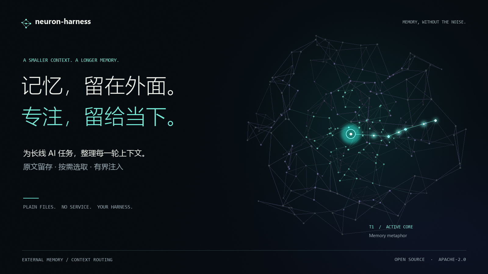
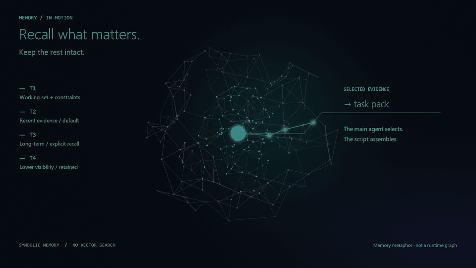
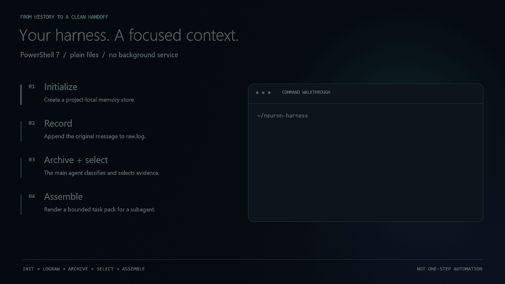

# neuron-harness skill

**跨 harness 的 Agent Skill：为长线任务提供外置记忆与上下文路由。**

[](https://github.com/BlackCatt99/neuron-harness-skill/actions/workflows/ci.yml)
[](LICENSE)
[](https://github.com/PowerShell/PowerShell)

[English](README.en.md) | **中文**



> **目标**：让长线会话的每一轮都只带相关信息——减少历史对注意力的稀释，且**原文永不丢失**。
> **手段**：把历史搬到模型外面，每轮按需重新打包。
> **边界**：这是**无限存储 + 有界注入**，不是无限上下文窗口。

给长线 AI 会话用的外置记忆与上下文路由 **skill**，不是另一套 agent 框架。**不是上下文压缩**：压缩把历史变短、细节
有损；它不压缩，只做选择——全部历史原样留在磁盘，每轮只挑真正相关的送进模型。

[](docs/brand/neuron-harness-film.mp4)

**[观看新版宣传短片（24 秒，无声）](docs/brand/neuron-harness-film.mp4)** · [静态预览](docs/brand/memory-network.png) · [宣传海报](docs/brand/poster.zh.png)

<details>
<summary>查看完整架构：记录 → 归档与选取 → 任务包 → 子代理 → staging 校验</summary>

[](docs/architecture.png)

</details>

> 结构上仿神经元：T1 是当前激活的核心，T2–T4 逐级向边缘扩散，长期不访问则衰减下沉。
> 机制上是符号系统——关键词/标签匹配、显式层参数、绝对天数阈值，**不是**权重矩阵与向量相似度。
> 这个区别很重要：不要把「像神经网络」说成「是神经网络」。

## 它解决什么

**问题**：长线任务里，模型每轮都被迫带着全部历史。上下文越长，注意力越被稀释——真正相关的
几条信息淹没在大量过期内容里。而粗暴压缩会丢细节，事后无法追溯。

**做法**：把「记住什么」和「这轮给模型看什么」从模型内部搬到外部可审计的状态里，职责拆开：

- **主模型只做三件事**：归档（把消息拆成条目）、选取（决定这轮要哪些旧材料）、组装（发任务包）。
- **实际工作交给短生命周期子代理**，它只收到一个小而干净的任务包，不继承主会话。
- **原文永不删除**。所谓遗忘只是降低检索可见性（T1–T4 分层），并提高到达成本——
  需要时能完整取回，而不是被摘要替换掉。

## 为什么不用现成方案

两个常被拿来对比的方向：[Letta / MemGPT](https://docs.letta.com/) 与 LangChain 的内置 memory。
它们解决的问题和本项目的取舍不同，不是谁替代谁。

| | Letta / MemGPT | LangChain memory | neuron-harness |
|---|---|---|---|
| 记忆在哪 | 记忆块 + 归档存储，由 agent 通过工具自编辑 | 检查点持久化会话状态；长期记忆另接存储 | 项目目录下的纯文本文件，`git diff` 可读可审 |
| 谁决定放什么进上下文 | 模型在 agent loop 里自己调工具读写 | 应用代码配置 trim / summarize / 检索 | 主模型按判据归档与选取，脚本兑现硬规则 |
| 历史被压缩吗 | 上下文内是摘要式记忆块，原文在归档层 | summarization middleware 会用摘要替换早期历史 | **从不压缩**。原文永久保留于 `raw.log` 与 `archive/` |
| 是否需要运行时 | Agent SDK 或自托管 App Server / 云 | 库，跑在你的应用进程里 | 单个 PowerShell 7 脚本，无服务、无数据库 |
| 状态可审计性 | 依赖其存储层与 API | 取决于所选 checkpointer | 人类可读文件 + 只追加日志，直接看、直接改 |

**取舍说明（不是优劣，是场景）**

- 需要 agent 自主管理记忆、且接受引入框架与存储层 → **Letta** 更合适。
- 需要把记忆嵌进既有应用、用代码精确控制每轮拼装 → **LangChain** 更合适。
- 需要**跨会话、跨子代理、跨 harness** 的外部状态，要求原文可追溯、无服务依赖、
  人能直接用文本工具审查 → 本项目的目标场景。

明确不做的：不做向量检索服务、不做 agent 自编辑记忆、不做托管平台。
检索走标签与关键词匹配（见「边界与已知限制」），这是刻意的简化，不是尚未实现。

## 边界与已知限制

写清楚边界比堆卖点更有用。分两类：**能力边界**是设计如此、不会改变；
**当前限制**是这一版实现的短板，后续可改。

**能力边界（设计如此）**

- **不扩大窗口**。每轮注入受 `budget`（默认 24000 字符）约束，模型单次能看的内容不变。
  这是无限存储 + 有界注入，不是无限上下文窗口。
- **不消除注意力衰减**。它减少稀释——把无关历史挡在外面——但相关材料本身很多时，衰减依然存在。
- **不保证召回完整**。检索基于标签、关键词与显式层参数，**没有向量相似度**；措辞差异可能漏检。
  漏检的条目没有被删除，只是这轮没被选中，可显式扩层或 `Fetch` 取回。
- **不替代模型判断**。哪些该归档、哪些该召回、约束正文是否真有原话支撑——这些语义判断由模型做；
  脚本只兑现格式、来源存在性、预算、锁与原子写这类硬不变量。

**当前限制（可改进）**

- 单全局写锁：并发保证正确性，不保证吞吐。
- `Next-Id` 每次递归扫描 archive，条目到数百后编号计算变慢。
- 语义来源校验只能做到格式与存在性，语义蕴含需要模型或人工复核（见上面的能力边界）。
- Linux 已由 CI 实际执行测试；macOS 尚未纳入 CI（见「平台支持」）。

## 核心概念

| 概念 | 含义 |
|---|---|
| 工作集（working set） | 持久对象，每任务线一份，六节结构（架构视图/依赖图/决策日志/硬约束指针/未决问题/产物锚点） |
| 任务包（task pack） | 每轮从工作集 + 选中证据渲染出的视图，字符预算内裁剪 |
| T1–T4 | T1 工作集与活跃约束（每轮强制注入）；T2 近期证据（默认检索面）；T3 长期/决策分期；T4 功能性遗忘层 |
| 三档检索 | 档 1 连续推进不检索；档 2 沿依赖图邻域召回；档 3 全量重估 |
| staging | 子代理产出先进缓冲，来源校验通过才入库 |

## 安装与每轮接入

前置依赖：**Git + PowerShell 7**。以下安装器属于 v0.2.0；旧发布包不含这些入口，请使用包含 `scripts/integrate.ps1` 的版本。
先把 skill 下载到独立目录，不要放进需要记录历史的业务项目里：

```powershell
git clone https://github.com/BlackCatt99/neuron-harness-skill.git neuron-harness
Set-Location neuron-harness

# 改成需要启用记忆的已有项目绝对路径
$project = 'C:/work/my-project'
pwsh -NoProfile -File ./scripts/assemble.ps1 -Mode Init -Project $project

# Plan 默认只读：先查看将写哪些项目文件
pwsh -NoProfile -File ./scripts/integrate.ps1 -Action Plan -Harness zcode -Project $project
pwsh -NoProfile -File ./scripts/integrate.ps1 -Action Install -Harness zcode -Project $project
pwsh -NoProfile -File ./scripts/integrate.ps1 -Action Status -Harness zcode -Project $project
```

展示名为 `neuron-harness skill`，公开仓库名为 `neuron-harness-skill`。
skill ID、安装目录名和状态目录仍为 `neuron-harness`，避免破坏已有接入。
安装器显式指定 harness，不靠猜测静默更改项目规则。可选 `zcode`、`codex`、`claude`、`cursor`、`generic`。

| harness | 项目入口 | 本版接入级别 |
|---|---|---|
| ZCode / Codex / generic | `AGENTS.md` 短托管块 | 指令引导；依赖当前环境加载和遵循项目规则 |
| Claude Code | `CLAUDE.md` 短托管块 | 指令引导；可额外配置原生消息提交 hook |
| Cursor | `AGENTS.md` 兼容入口 | 指令引导，尚未在实际 Cursor 中验证；未写专用 rules 配置 |

**Claude Code 自动记录提交原文：**

```powershell
pwsh -NoProfile -File ./scripts/integrate.ps1 -Action Plan -Harness claude -EnablePromptHook -Project $project
pwsh -NoProfile -File ./scripts/integrate.ps1 -Action Install -Harness claude -EnablePromptHook -Project $project
```

它在项目 `.claude/settings.json` 合并 `UserPromptSubmit` 命令 hook。hook 记录收到的消息原文并注入短协议，
**不自动完成语义归档、证据选取和子代理交接**。这些仍由主代理按协议驱动。
没有稳定 `prompt_id` 的事件不保证重试去重；含日志保留分隔符的输入会被拒绝，不静默改写。
原文和 hook 回执仅存本地，可能含敏感信息，勿提交 `.neuron-harness/`。

安装后开新会话，用虚构消息验证 `raw.log` 是否新增、主代理是否遵循短协议。
`Status` 检查配置完整性，**不能证明真实 harness 已执行**。仅 `clone + Init` 也不等于安装 skill 或每轮自动运行。

安装器保留原有指令正文，只维护自己的标记区；修改前备份。托管区被手改、配置冲突或安装中断时拒绝继续，
不会拿整份备份覆盖用户新内容。卸载保留历史库及原文：

```powershell
pwsh -NoProfile -File ./scripts/integrate.ps1 -Action Uninstall -Harness zcode -Project $project
# 仅当 Status 报告未完成事务时，核验后恢复到事务前状态
pwsh -NoProfile -File ./scripts/integrate.ps1 -Action Recover -Harness zcode -Project $project
```

完整安全边界、恢复与实测方法见 [接入说明](integration/README.md)。

## 跨 harness 使用

脚本层只依赖 **PowerShell 7**，不绑定任何特定代理环境。任何能执行命令、能把
`templates/*.md` 的短判据注入模型的 harness 都可以接入：

- **ZCode / Claude Code / Cursor / 自建 agent**：把本目录放进对应 skills 路径，或直接调用
  `scripts/assemble.ps1`。
- 判据走 `templates/`，主模型**不需要**读 SKILL.md 全文；SKILL.md 是规格书，供维护与排障时读。
- 数据目录固定为项目根的 `.neuron-harness/`，由 `Init` 创建。

### 最小接入步骤

[](docs/brand/quickstart.png)

动画中的命令省略了部分参数，仅展示接入顺序，不代表一键自动化或速度实测。完整参数见下方。
[静态版本](docs/brand/quickstart.png)。

```powershell
# 1. 初始化项目状态库
pwsh -NoProfile -File scripts/assemble.ps1 -Mode Init -Project <项目根>

# 2. 记录用户消息（判断为任务切换/依赖变更时补 -Signal）
pwsh -NoProfile -File scripts/assemble.ps1 -Mode LogRaw -TaskId <线名> -ContentFile <消息文件> -Project <项目根>

# 3. 归档：按 templates/archive.md 判断后逐条入库
pwsh -NoProfile -File scripts/assemble.ps1 -Mode Archive -Type evidence -TaskId <线名> `
  -Summary "[对象|动作] 一句话" -Source <MSG id> -ContentFile <条目文件> -Project <项目根>

# 4. 组装任务包
pwsh -NoProfile -File scripts/assemble.ps1 -Mode Assemble -TaskId <线名> `
  -InstructionFile <本轮指令> -Evidence E0001,E0002 -Project <项目根> -OutFile pack.md
```

## 平台支持

- **Windows**：完整支持。28 组集成测试在主开发机与 CI 的 `windows-latest` 上全绿。
- **Linux**：代码路径已去除 Windows 专有依赖（正斜杠路径、`GetTempPath`、不依赖
  `-WindowStyle`、不假定 PATH 里有 `pwsh`），并由 CI 的 `ubuntu-latest` 实际执行全部
  测试。徽章即真实结果，不是声明。
- **macOS**：未在 CI 覆盖，理论上与 Linux 同路径，但**未经实测**。
- **共享/网络文件系统（UNC、NFS）**：锁与 rename 原子性未验证，不在支持范围。

## 测试

```powershell
pwsh -NoProfile -File tests/e2e.ps1          # 28 tests / 28 组，退出码 0 表示全绿
pwsh -NoProfile -File tests/integration.tests.ps1    # 项目安装、所有权、恢复
pwsh -NoProfile -File tests/prompt-hook.tests.ps1    # 原文采集、事件回执
pwsh -NoProfile -File tests/e2e.ps1 -KeepArtifacts   # 保留临时项目便于排查
pwsh -NoProfile -File tests/e2e.ps1 -ScriptPath <旧版脚本>  # 反向验证新用例真能抓到旧缺陷
```

`-ScriptPath` 是这套测试的设计要点：任何新增回归都必须在修复前的脚本上**确实失败**，
否则就是假阳性。历史缺陷与对应修复见 [OPERATIONS.md](OPERATIONS.md)。

欢迎贡献——提交前的三条硬要求见 [CONTRIBUTING.md](CONTRIBUTING.md)（测试全绿、新用例经反向
验证、文档同步）。

## 结构

```
neuron-harness/
├── SKILL.md              规格书（harness 契约、红线、判据）
├── OPERATIONS.md         运营备忘录（版本血统、实证偏差账本、已知限制）
├── README.md             本文件
├── LICENSE               Apache-2.0 全文
├── NOTICE                版权与项目声明
├── manifest.json         版本、许可证与模板最低版本映射
├── templates/            4 份短判据，运行时注入模型（tier/archive/relevance/review）
├── scripts/assemble.ps1  确定性执行器（17 个 Mode，写锁、原子写、索引重写）
├── integration/          短运行协议、项目接入与恢复说明
├── scripts/integrate.ps1 项目规则安装器（Plan/Install/Status/Uninstall/Recover）
├── scripts/prompt-hook.ps1 Claude 原生提交原文采集适配器（可选）
├── tests/e2e.ps1         28 组集成测试
└── docs/                 双语架构图、品牌图与动画；brand/render_visuals.py 可重建新版素材
```

## 血统

本 skill 由 `context-router` v5.4 重命名而来，版本号重新起算为 v0.1。前身 v5.1–v5.4 的
全部实证修复与回归均被继承，详见 OPERATIONS.md 的偏差账本。

## License

[Apache License 2.0](LICENSE) — 可自由使用、修改、商用与闭源分发，需保留版权与许可声明；
内含显式专利授权。贡献者条款见 [NOTICE](NOTICE)。
