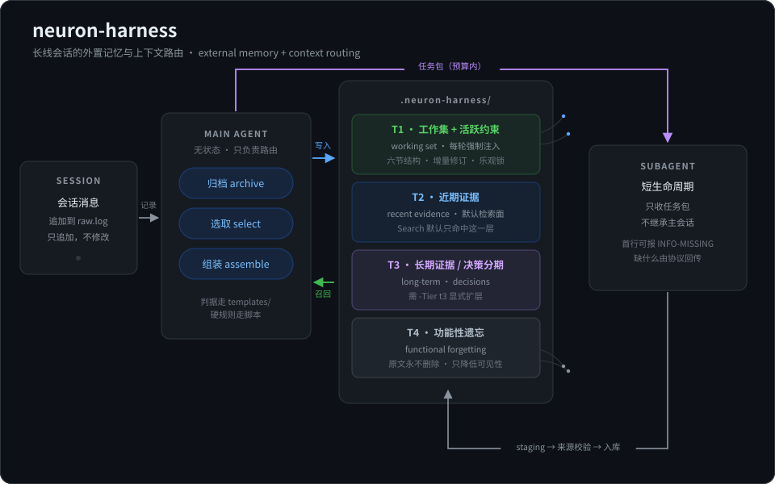

# neuron-harness

[](https://github.com/BlackCatt99/neuron-harness/actions/workflows/ci.yml)
[](LICENSE)
[](https://github.com/PowerShell/PowerShell)

> **目标**：让长线会话的每一轮都只带相关信息——减少历史对注意力的稀释，且**原文永不丢失**。
> **手段**：把历史搬到模型外面，每轮按需重新打包。
> **边界**：这是**无限存储 + 有界注入**，不是无限上下文窗口。

给长线 AI 会话用的外置记忆与上下文路由 harness。**不是上下文压缩**：压缩把历史变短、细节
有损；它不压缩，只做选择——全部历史原样留在磁盘，每轮只挑真正相关的送进模型。



> 结构上仿神经元：T1 是当前激活的核心，T2–T4 逐级向边缘扩散，长期不访问则衰减下沉。
> 机制上是符号系统——关键词/标签匹配、显式层参数、绝对天数阈值，**不是**权重矩阵与向量相似度。
> 这个区别很重要：不要把「像神经网络」说成「是神经网络」。

## 它解决什么

**问题**：长线任务里，模型每轮都被迫带着全部历史。上下文越长，注意力越被稀释——真正相关的
几条信息淹没在大量过期内容里。而粗暴压缩会丢细节，事后无法追溯。

**做法**：把「记住什么」和「这轮给模型看什么」从模型内部搬到外部可审计的状态里，职责拆开：

- **主模型只做三件事**：归档（把消息拆成条目）、选取（决定这轮要哪些旧材料）、组装（发任务包）。
- **实际工作交给短生命周期子代理**，它只收到一个小而干净的任务包，不继承主会话。
- **原文永不删除**。所谓遗忘只是降低检索可见性（T1–T4 分层），并提高到达成本——
  需要时能完整取回，而不是被摘要替换掉。

## 边界与已知限制

写清楚边界比堆卖点更有用。分两类：**能力边界**是设计如此、不会改变；
**当前限制**是这一版实现的短板，后续可改。

**能力边界（设计如此）**

- **不扩大窗口**。每轮注入受 `budget`（默认 24000 字符）约束，模型单次能看的内容不变。
  这是无限存储 + 有界注入，不是无限上下文窗口。
- **不消除注意力衰减**。它减少稀释——把无关历史挡在外面——但相关材料本身很多时，衰减依然存在。
- **不保证召回完整**。检索基于标签、关键词与显式层参数，**没有向量相似度**；措辞差异可能漏检。
  漏检的条目没有被删除，只是这轮没被选中，可显式扩层或 `Fetch` 取回。
- **不替代模型判断**。哪些该归档、哪些该召回、约束正文是否真有原话支撑——这些语义判断由模型做；
  脚本只兑现格式、来源存在性、预算、锁与原子写这类硬不变量。

**当前限制（可改进）**

- 单全局写锁：并发保证正确性，不保证吞吐。
- `Next-Id` 每次递归扫描 archive，条目到数百后编号计算变慢。
- 语义来源校验只能做到格式与存在性，语义蕴含需要模型或人工复核（见上面的能力边界）。
- Linux/macOS 的代码路径已去除平台专有依赖，但未经真实环境验证（见「平台支持」）。

## 核心概念

| 概念 | 含义 |
|---|---|
| 工作集（working set） | 持久对象，每任务线一份，六节结构（架构视图/依赖图/决策日志/硬约束指针/未决问题/产物锚点） |
| 任务包（task pack） | 每轮从工作集 + 选中证据渲染出的视图，字符预算内裁剪 |
| T1–T4 | T1 工作集与活跃约束（每轮强制注入）；T2 近期证据（默认检索面）；T3 长期/决策分期；T4 功能性遗忘层 |
| 三档检索 | 档 1 连续推进不检索；档 2 沿依赖图邻域召回；档 3 全量重估 |
| staging | 子代理产出先进缓冲，来源校验通过才入库 |

## 跨 harness 使用

脚本层只依赖 **PowerShell 7**，不绑定任何特定代理环境。任何能执行命令、能把
`templates/*.md` 的短判据注入模型的 harness 都可以接入：

- **ZCode / Claude Code / Cursor / 自建 agent**：把本目录放进对应 skills 路径，或直接调用
  `scripts/assemble.ps1`。
- 判据走 `templates/`，主模型**不需要**读 SKILL.md 全文；SKILL.md 是规格书，供维护与排障时读。
- 数据目录固定为项目根的 `.neuron-harness/`，由 `Init` 创建。

### 最小接入步骤

```powershell
# 1. 初始化项目状态库
pwsh -NoProfile -File scripts/assemble.ps1 -Mode Init -Project <项目根>

# 2. 记录用户消息（判断为任务切换/依赖变更时补 -Signal）
pwsh -NoProfile -File scripts/assemble.ps1 -Mode LogRaw -TaskId <线名> -ContentFile <消息文件> -Project <项目根>

# 3. 归档：按 templates/archive.md 判断后逐条入库
pwsh -NoProfile -File scripts/assemble.ps1 -Mode Archive -Type evidence -TaskId <线名> \
  -Summary "[对象|动作] 一句话" -Source <MSG id> -ContentFile <条目文件> -Project <项目根>

# 4. 组装任务包
pwsh -NoProfile -File scripts/assemble.ps1 -Mode Assemble -TaskId <线名> \
  -InstructionFile <本轮指令> -Evidence E0001,E0002 -Project <项目根> -OutFile pack.md
```

## 平台支持

- **Windows**：完整支持。27 组集成测试在主开发机与 CI 的 `windows-latest` 上全绿。
- **Linux**：代码路径已去除 Windows 专有依赖（正斜杠路径、`GetTempPath`、不依赖
  `-WindowStyle`、不假定 PATH 里有 `pwsh`），并由 CI 的 `ubuntu-latest` 实际执行全部
  测试。徽章即真实结果，不是声明。
- **macOS**：未在 CI 覆盖，理论上与 Linux 同路径，但**未经实测**。
- **共享/网络文件系统（UNC、NFS）**：锁与 rename 原子性未验证，不在支持范围。

## 测试

```powershell
pwsh -NoProfile -File tests/e2e.ps1          # 27 组，退出码 0 表示全绿
pwsh -NoProfile -File tests/e2e.ps1 -KeepArtifacts   # 保留临时项目便于排查
pwsh -NoProfile -File tests/e2e.ps1 -ScriptPath <旧版脚本>  # 反向验证新用例真能抓到旧缺陷
```

`-ScriptPath` 是这套测试的设计要点：任何新增回归都必须在修复前的脚本上**确实失败**，
否则就是假阳性。历史缺陷与对应修复见 [OPERATIONS.md](OPERATIONS.md)。

## 结构

```
neuron-harness/
├── SKILL.md              规格书（harness 契约、红线、判据）
├── OPERATIONS.md         运营备忘录（版本血统、实证偏差账本、已知限制）
├── README.md             本文件
├── LICENSE               Apache-2.0 全文
├── NOTICE                版权与项目声明
├── manifest.json         版本、许可证与模板最低版本映射
├── templates/            4 份短判据，运行时注入模型（tier/archive/relevance/review）
├── scripts/assemble.ps1  确定性执行器（17 个 Mode，写锁、原子写、索引重写）
└── tests/e2e.ps1         27 组集成测试
```

## 血统

本 skill 由 `context-router` v5.4 重命名而来，版本号重新起算为 v0.1。前身 v5.1–v5.4 的
全部实证修复与回归均被继承，详见 OPERATIONS.md 的偏差账本。

## License

[Apache License 2.0](LICENSE) — 可自由使用、修改、商用与闭源分发，需保留版权与许可声明；
内含显式专利授权。贡献者条款见 [NOTICE](NOTICE)。
